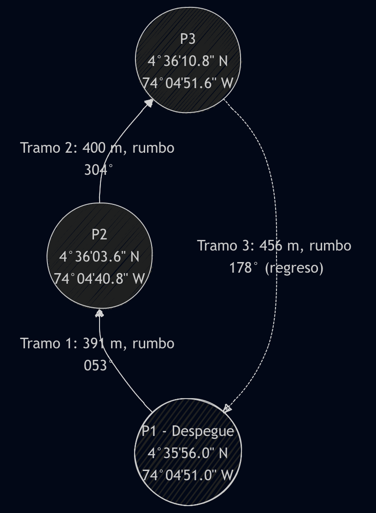
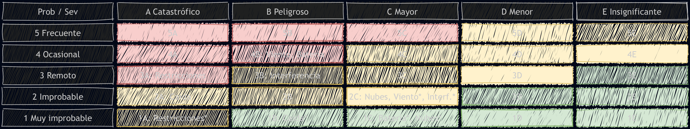
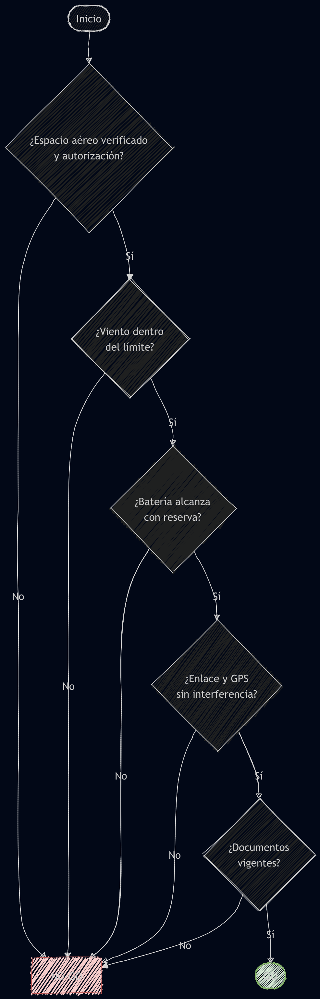

# Parcial-UAS-II

## Punto 1. Alfabeto fonético

Procedimiento: separé la matrícula carácter por carácter y reemplacé cada uno por su palabra del alfabeto OACI. Los números se leen dígito por dígito y el guion no se pronuncia. HK es el prefijo de Colombia.

**a) HK-4Q7M:** Hotel - Kilo - Four - Quebec - Seven - Mike

**b) Hotel - Kilo - Seven - Quebec - Three - Lima:** aquí hice el proceso al revés. Tomé la inicial de cada palabra (H, K, Q, L) y escribí los números como dígitos (7, 3). Queda **HK-7Q3L**.

**c) HK-8B2X:** Hotel - Kilo - Eight - Bravo - Two - X-ray

---

## Punto 2. Comunicaciones aeronáuticas

**Mensaje:**

> "Bogotá Control, Hotel Kilo Four Quebec Seven Mike, UAS multirrotor, posición 400 metros al noreste del punto de despegue, altitud cuatro cero cero pies AGL. Intención: continuar hasta el punto P3 y regresar a P1 en cinco minutos. Condiciones: dron a la vista, batería sesenta por ciento, enlace estable, sin tráfico."

**Expresiones:**

| Expresión | Significado | Ejemplo |
|---|---|---|
| Roger | Recibí el mensaje. No implica que vaya a hacer algo. | ATC: "QNH uno cero uno ocho." → UAS: "Roger." |
| Wilco | Entendido y voy a cumplir. Se usa con instrucciones. | ATC: "Descienda a 200 pies." → UAS: "Wilco, descendiendo a 200 pies." |
| Standby | Espere, ya le respondo. No es aprobación. | ATC: "Hotel Kilo..., standby." → el piloto espera sin transmitir. |
| Monitor | Escuche esa frecuencia, sin transmitir. | ATC: "Monitor torre 118.1." → el piloto cambia y solo escucha. |
| Say Again | Repita, no se entendió. | UAS: "Say again altitud." → ATC repite. |

La diferencia principal está entre Roger y Wilco: a una información (como el QNH) se responde Roger, y a una orden (como descender) se responde Wilco.

---

## Punto 3. Coordenadas

### a) GMS a decimal

Fórmula: `grados + minutos/60 + segundos/3600`

- Latitud: 4 + 35/60 + 56/3600 = 4 + 0.5833 + 0.0156 = **4.5989° N**
- Longitud: 74 + 4/60 + 51/3600 = 74 + 0.0667 + 0.0142 = **74.0808° W**

### b) Decimal a GMS

Procedimiento: la parte decimal se multiplica por 60 para sacar los minutos, y lo que sobra se vuelve a multiplicar por 60 para los segundos.

- Latitud 4.5990: 0.5990 x 60 = 35.94 → 35'; 0.94 x 60 = 56.4" → **4° 35' 56.4" N**
- Longitud 74.0800: 0.0800 x 60 = 4.8 → 04'; 0.8 x 60 = 48" → **74° 04' 48" W**

Las coordenadas de a) y b) son casi el mismo punto. Solo difieren en unos 90 m de longitud.

### c) Ruta de tres puntos

Hice una ruta cerrada que empieza en la coordenada del inciso a), a 100 m de altura y a 8 m/s. Es una ruta de ejemplo; en la realidad habría que revisarla en el Visor Geográfico UAS.

Conversión de P2 y P3 (mismo procedimiento del inciso b):

- **P2** (4.6010 N, 74.0780 W):
  - 0.6010 x 60 = 36.06 → 36'; 0.06 x 60 = 3.6" → **4° 36' 03.6" N**
  - 0.0780 x 60 = 4.68 → 04'; 0.68 x 60 = 40.8" → **74° 04' 40.8" W**
- **P3** (4.6030 N, 74.0810 W):
  - 0.6030 x 60 = 36.18 → 36'; 0.18 x 60 = 10.8" → **4° 36' 10.8" N**
  - 0.0810 x 60 = 4.86 → 04'; 0.86 x 60 = 51.6" → **74° 04' 51.6" W**

| Punto | Decimal | GMS |
|---|---|---|
| P1 | 4.5989 N, 74.0808 W | 4° 35' 56.0" N, 74° 04' 51.0" W |
| P2 | 4.6010 N, 74.0780 W | 4° 36' 03.6" N, 74° 04' 40.8" W |
| P3 | 4.6030 N, 74.0810 W | 4° 36' 10.8" N, 74° 04' 51.6" W |

**Distancia y rumbo.** A la latitud de Bogotá, 1° de latitud ≈ 110.6 km y 1° de longitud ≈ 110.96 km.

Ejemplo con el tramo P1 → P2:
- Norte: 0.0021 x 110 600 ≈ 233 m
- Este: 0.0028 x 110 960 ≈ 314 m
- Distancia = √(233² + 314²) ≈ **391 m**
- Rumbo = arctan(314/233) ≈ **053°**

Con el mismo procedimiento salen los otros tramos:

| Tramo | Distancia | Rumbo |
|---|---|---|
| P1 → P2 | 391 m | 053° |
| P2 → P3 | 400 m | 304° |
| P3 → P1 | 456 m | 178° |
| Total | 1247 m | ≈ 2.6 min a 8 m/s |

---

## Punto 4. METAR

`METAR SKBO 141600Z 14021G26KT 5000 -RA BKN012 18/12 Q1018`

| Parte | Significado |
|---|---|
| SKBO | Aeropuerto El Dorado, Bogotá |
| 141600Z | Día 14 a las 16:00 UTC (11:00 hora Colombia) |
| 14021G26KT | Viento de 140° a 21 kt (≈ 10.8 m/s) con ráfagas de 26 kt (≈ 13.4 m/s) |
| 5000 | Visibilidad de 5 km |
| -RA | Lluvia ligera |
| BKN012 | Nubes fragmentadas a 1200 ft (≈ 366 m) |
| 18/12 | Temperatura 18 °C, punto de rocío 12 °C |
| Q1018 | QNH 1018 hPa |

**Riesgos:**
- **Viento:** es el mayor riesgo. 21 kt con ráfagas de 26 kt supera el límite de la mayoría de drones (unos 10-12 m/s). El dron puede perder estabilidad o no poder regresar.
- **Lluvia:** la mayoría de drones no son resistentes al agua.
- **Altura de Bogotá:** el aire es menos denso, así que las hélices empujan menos y la batería dura menos.
- **Nubes y visibilidad:** no son problema. Las nubes están más arriba de los 120 m máximos y 5 km alcanza para ver el dron.

**Decisión: NO-GO.** Aunque la visibilidad y las nubes están bien, el viento con ráfagas y la lluvia hacen que no sea seguro volar. Hay que esperar a que mejore el clima.

---

## Punto 5. RAC 100

El RAC 100 (Resolución 01983 de 2023 de la Aerocivil) divide las operaciones según el riesgo en categoría **abierta** (no comercial, hasta 25 kg), **específica** (comercial o fuera de los límites de la abierta, hasta 250 kg) y **certificada**. Todo dron de 200 g o más debe registrarse.

| | Recreativo en área abierta | Comercial urbano | BVLOS |
|---|---|---|---|
| Categoría | Abierta | Específica | Específica |
| Qué verificar | Peso ≤ 25 kg, vuelo a la vista, máx. 120 m, zona permitida en el Visor Geográfico | Cercanía a aeropuertos, personas debajo, obstáculos, interferencias | Espacio aéreo, corredor de vuelo, enlace C2 y GPS, cómo evitar otras aeronaves |
| Restricciones | No sobre personas, no cerca de aeropuertos, de día | Área de seguridad, distancia a personas, horarios, permisos locales | Solo dentro del corredor aprobado, procedimientos por pérdida de enlace |
| Documentos | Registro del dron | Certificado de explotador, certificado de piloto, registro, póliza, autorización de vuelo | Todo lo anterior + análisis de riesgo específico y plan de emergencia |

**Justificación:** el RAC 100 pide más requisitos mientras más riesgo hay.
- **Recreativo:** casi no hay terceros y el piloto ve el dron, así que basta con registrarlo.
- **Comercial urbano:** hay gente debajo y es un negocio, por eso se pide demostrar capacitación y tener un seguro.
- **BVLOS:** el piloto ya no ve el dron y todo depende de la tecnología, por eso es el que más análisis y autorizaciones necesita.

---

## Punto 6. Caso integrador

**Datos:** dron de 12 kg, autonomía 45 min, misión de 35 min, viento 18 kt con ráfagas de 25 kt, visibilidad 5 km, nubes bajas, restricciones desconocidas y posible interferencia.

### Cálculos de autonomía

1. **Margen nominal:** 45 - 35 = 10 min, o sea 22 %. Normalmente se deja una reserva de 20-30 %, así que ya está en el límite.
2. **Con reserva del 25 %:** 45 x 0.75 = 33.75 min útiles < 35 → **no alcanza**.
3. **Con viento:** asumí un 20 % más de consumo por el viento.
   - 45 / 1.2 = 37.5 min
   - Con reserva del 20 %: 37.5 x 0.8 = **30 min útiles**
   - Faltan 5 min.
4. **Regreso contra el viento:** 18 kt ≈ 9.3 m/s y 25 kt ≈ 12.9 m/s. Si el dron vuela a 12 m/s, de regreso avanzaría a 12 - 9.3 = 2.7 m/s, y con una ráfaga iría hacia atrás.

Solo con estos cálculos la misión ya no es viable como está planeada.

### Peligros y riesgo

Usé la matriz OACI:
- **Probabilidad:** de 1 (muy improbable) a 5 (frecuente)
- **Severidad:** de A (catastrófico) a E (insignificante)

| Peligro | Riesgo | Mitigación | Riesgo después |
|---|---|---|---|
| Viento y ráfagas | 4B Intolerable | Volar solo con viento dentro del límite del fabricante | 2C Tolerable |
| Batería insuficiente | 4B Intolerable | Dividir en 2 vuelos de ~17.5 min, regreso automático al 30 % | 1C Aceptable |
| Restricciones desconocidas | 3A Intolerable | Revisar Visor Geográfico y NOTAM, pedir autorización | 1A Tolerable |
| Interferencia electromagnética | 3B Tolerable | Probar el enlace en sitio, calibrar brújula, configurar failsafe | 2C Tolerable |
| Nubes bajas / perder de vista el dron | 2C Tolerable | Volar por debajo de las nubes, poner un observador | 1C Aceptable |
| Caída de un dron de 12 kg sobre personas | 2A Tolerable | Acordonar el área, ruta sin gente, paracaídas | 1B Aceptable |

### Requisitos normativos

Es una misión comercial, así que entra en **categoría específica**. Hay que verificar:
- Certificado de explotador
- Certificado de piloto y certificado médico
- Registro del dron
- Póliza de responsabilidad civil
- Autorización de vuelo de la Aerocivil
- Consulta del Visor Geográfico y los NOTAM

### Decisión

| Verificación | Cumple |
|---|---|
| Espacio aéreo y autorización | No |
| Viento dentro del límite | No |
| Batería con reserva | No |
| Enlace sin interferencia | No |
| Documentación | Por verificar |

**NO-GO.** Fallan 4 de las 5 verificaciones. Lo más claro es la autonomía: hay 30 min útiles para una misión de 35, y además el regreso es contra el viento. Sería GO solo si:
- El viento baja
- Se tiene la autorización
- El enlace funciona bien en la prueba
- La misión se divide en dos vuelos con cambio de batería (30 min útiles cada uno para 17.5 min de vuelo, 42 % de margen)

### Plan de contingencia

| Situación | Acción |
|---|---|
| Pérdida de enlace | Regreso automático (RTH). Si no vuelve, aterriza en el punto alterno. |
| Pérdida de GPS | Modo manual, mantener el dron a la vista y aterrizar. |
| Batería al 30 % | Regresar sí o sí. Al 20 %, aterrizar donde sea seguro. |
| Ráfaga fuerte | Bajar altura, regresar y cancelar la misión. |
| Aparece otra aeronave | Descender y dejarle el paso. |
| Accidente | Asegurar la zona, desconectar la batería, reportar a la Aerocivil y guardar los registros de vuelo. |

---

## Referencias

- Aerocivil. ABC RAC 100 - UAS/Drones.
- Aerocivil. Circulares 100-MAUT-5.0-22-010, 011 y 012 (registro, explotador y autorización de vuelo UAS).
- OACI. Anexo 10 (fraseología), Anexo 3 (METAR) y Doc 9859 (gestión de la seguridad operacional).

